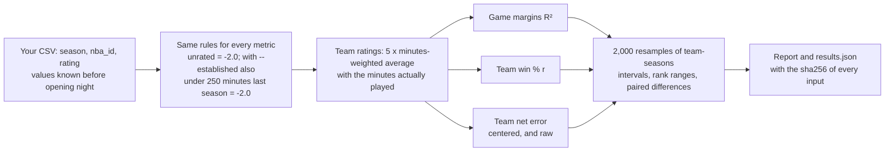

# Hoop Impact Bench (HIB)

Do last season's impact-metric values predict this season?


HIB is an open benchmark for all-in-one NBA player impact metrics. It aims to be a standardized, open and reproducible
test of how well an impact metric measures a player's per-100-possession value. It takes each metric's values from the
season prior and measures how well they predict the following season's games. Each metric is scored on the same 7,230
games under the same rules and tests.

**2026-27 leaderboards**, updated every morning: [hoopimpactbench.org](https://hoopimpactbench.org/) (every board, with the data files) and [lumahoops.org/bench](https://lumahoops.org/bench) (the same boards with game and player pages). Rules: [live/PROTOCOL.md](live/PROTOCOL.md).

**Data.** The leaderboard files are open to any site or script (JSON and CSV, CC BY 4.0), updated every morning at
about 09:30 UTC. Base URL: `https://hoopimpactbench.org/`

| File | Contents |
|---|---|
| `live/results/frozen_full.json` | Preseason board, Full forecast (the default view): each metric's net error (centered, the ranking test; raw; offset), game R², team win % r, 90% ranges, rank ranges, W-L, label, source and sha256 |
| `live/results/frozen.json` | Preseason board, Established players (the rule registered before the season), same fields |
| `live/results/daily.json`, `daily_established.json` | Dynamic board, Full forecast (the default view) and Established players, same fields |
| `live/results/<board>_picks.csv` | Every game: teams, final score, and each metric's home-minus-away team rating (positive = the metric rates the home team higher) |
| `live/results/<board>_games.csv` | Every game: each metric's predicted margin on the scoring run's fitted line |
| `live/results/<board>_history.csv` | Each metric's scores after every update (net error columns from 2026-11-06; earlier rows filled in from the saved files) |
| `launch/full-forecast.json`, `established-players.json` | The historical tables, 2020-21 to 2025-26 |

`<board>` is `frozen_full`, `frozen`, `daily` or `daily_established`. Every file states its rules in `rules`; no field
changes meaning between versions (from 2.0.0, `net_rmse` is the raw error and `net_rmse_centered` the ranked one).

## News

- 2026-11-06: version 2.0.0 changes two scoring rules on every board, for 2026-27 and for 2020-21 to 2025-26.
  - Team net error centered. Each metric's team ratings are shifted so its average team is 0 in each season, the same
    as the opponent-adjusted margins they are compared with. The shift is one number per metric per season, computed
    from the ratings and minutes only, never from game results. Prior to that, the gap between a metric's average team
    value and zero was added to every team's error. Part of the gap originated from HIB's own -2.0 for rookies and
    low-minute players, which lowered every metric's average team by 1.1 to 1.6 points. The uncentered score stays on
    every board as "raw". Centering does not change game margin R², team win % r or W-L.
  - Rookies and low-minute players count at each metric's own rating by default. The rule that rates every player
    under 250 minutes the season before, rookies included, at -2.0 for every metric (Taylor Snarr, 2020) is now a
    switch on every board, "Established players". A player a metric does not rate still counts as -2.0. On the
    preseason board this changes every score, W-L included. The dynamic board already worked this way.
  - Every score published before this change is still published: the face-value net error as "raw" on every board, and
    the preseason board's old view as Established players. Earlier versions of every results file are in the
    repository's history.
- 2026-11-01: version 1.2.0 adds three metrics: xPM (George Berry, VORP.app), Danny Harlan's EPM projection, and GRBNU
  (Mike Gribanov). It also re-solves the two RAPM reference rows the way LUMA's site solves its RAPM (counted
  possessions, ridge penalty 10,000). Scores of the metrics already listed did not change; their rank ranges did,
  because there are more metrics. The live 2026-27 track keeps the v1.1.0 harness.
- 2026-11-01: the live 2026-27 track. The preseason board computes every 2026-27 game using each metric's ratings from before opening night; the dynamic board uses each metric's ratings as published on the morning of each game day.
- 2026-10-30: version 1.1.0 adds a reference row, last season's plain RAPM (no prior), after a reader asked how raw
  RAPM carries forward. No ranked score changed.
- 2026-10-29: version 1.0.0 and the first results, nine public metrics over the 2020-21 to 2025-26 seasons.

## Results

The tables score each metric's ratings from before each season on the regular seasons 2020-21 to 2025-26 (7,230 games,
180 team-seasons), ranked by team net error, centered (the ranking test). The tests are explained under
[How it works](#how-it-works).

### Full forecast

The default view: every player counts at the metric's own rating, rookies and low-minute players included. A player a
metric does not rate counts as -2.0.

| Rank | Metric | Team net error (90% interval) | Raw | Game margins R² (90% interval) | Team win % r |
|---|---|---|---|---|---|
|  | *Same-season RAPM (ceiling)* | 1.51 (1.36-1.65) | 1.89 | .267 (.251-.284) | .958 |
| 1-4 | xPM (VORP.app) | 2.79 (2.55-3.03) | 2.83 | .193 (.175-.210) | .825 |
| 1-3 | GRBNU | 2.81 (2.57-3.04) | 2.89 | .205 (.187-.221) | .835 |
| 1-5 | Danny Harlan's EPM projection | 2.88 (2.64-3.13) | 2.95 | .179 (.162-.195) | .829 |
| 2-5 | Pulse | 2.95 (2.70-3.21) | 3.09 | .177 (.159-.192) | .807 |
| 3-6 | OpenRAPM | 3.01 (2.77-3.23) | 3.40 | .171 (.154-.187) | .801 |
| 5-10 | LOKI † | 3.16 (2.88-3.43) | 3.47 | .196 (.178-.213) | .828 |
| 6-11 | ARC, 2-year † | 3.24 (3.01-3.49) | 3.34 | .156 (.138-.172) | .782 |
| 6-12 | LEBRON | 3.28 (2.99-3.54) | 3.38 | .154 (.137-.169) | .766 |
| 6-11 | DARKO | 3.28 (3.00-3.55) | 3.31 | .159 (.142-.175) | .773 |
| 7-11 | xRAPM | 3.31 (3.06-3.57) | 3.47 | .169 (.152-.185) | .782 |
| 6-12 | EPM | 3.32 (3.03-3.60) | 4.44 | .178 (.161-.194) | .808 |
| 9-12 | BPM (Basketball-Reference) | 3.50 (3.19-3.81) | 3.59 | .154 (.138-.170) | .768 |
|  | *Last season's RAPM, no prior (reference)* | 3.55 (3.23-3.85) | 3.57 | .132 (.115-.149) | .711 |
|  | *Last season's team (floor)* | 4.08 (3.71-4.44) | 4.18 | .092 (.077-.108) | .609 |
|  | *Everyone 0 (floor)* | 5.04 (4.63-5.41) | 5.04 | .000 (.000-.000) | .000 |

Reference rows (in italics, not ranked):

- Same-season RAPM (ceiling): plain RAPM (ridge regression on lineup stints, no prior, no box score; possessions
  counted from the box score, ridge penalty 10,000, solved the way LUMA's site solves its published RAPM) fit on the
  full regular season being scored. It is estimated from the same games it is scored on, so it serves as an in-sample
  upper reference.
- Last season's RAPM: the same plain RAPM fit on the previous season only and carried forward as the forecast.
- Everyone 0 (floor): every player is rated 0, so every team is league average. In the Established players view the
  -2.0 for low-minute players is the only thing that separates teams.
- Last season's team (floor): each player is assigned his main team's opponent-adjusted margin from the previous
  season, divided by 5, so the forecast uses only team strength from the previous season.

### Established players

Taylor Snarr's 2020 rule (`--established`): a player who played under 250 minutes the season before, rookies
included, counts as -2.0 for every metric, and so does a player a metric does not rate.

| Rank | Metric | Team net error (90% interval) | Raw | Game margins R² (90% interval) | Team win % r |
|---|---|---|---|---|---|
|  | *Same-season RAPM (ceiling)* | 1.69 (1.52-1.84) | 1.71 | .258 (.241-.275) | .946 |
| 1-4 | xPM (VORP.app) | 2.92 (2.67-3.17) | 2.94 | .177 (.160-.194) | .815 |
| 1-6 | Danny Harlan's EPM projection | 2.98 (2.73-3.23) | 3.07 | .172 (.155-.188) | .818 |
| 1-6 | LOKI † | 2.99 (2.73-3.24) | 3.08 | .170 (.152-.186) | .805 |
| 1-6 | GRBNU | 3.00 (2.76-3.25) | 3.04 | .182 (.165-.198) | .814 |
| 1-6 | Pulse | 3.01 (2.75-3.26) | 3.13 | .171 (.154-.187) | .800 |
| 4-8 | OpenRAPM | 3.12 (2.86-3.35) | 3.39 | .162 (.146-.178) | .786 |
| 6-11 | LEBRON | 3.22 (2.95-3.49) | 3.39 | .159 (.142-.175) | .770 |
| 6-11 | ARC, 2-year † | 3.28 (3.04-3.52) | 3.38 | .152 (.135-.169) | .776 |
| 7-12 | DARKO | 3.31 (3.03-3.59) | 3.36 | .155 (.138-.172) | .767 |
| 7-12 | EPM | 3.35 (3.07-3.63) | 3.87 | .157 (.141-.174) | .778 |
| 8-12 | xRAPM | 3.39 (3.13-3.65) | 3.48 | .161 (.144-.177) | .772 |
| 8-12 | BPM (Basketball-Reference) | 3.46 (3.12-3.78) | 3.50 | .154 (.136-.170) | .773 |
|  | *Last season's RAPM, no prior (reference)* | 3.45 (3.15-3.75) | 3.49 | .142 (.124-.159) | .725 |
|  | *Last season's team (floor)* | 3.96 (3.61-4.31) | 4.19 | .103 (.087-.120) | .629 |
|  | *Everyone 0 (floor)* | 4.42 (4.05-4.76) | 4.65 | .125 (.109-.141) | .678 |

How to read the tables:

- Rank is the range of places on team net error a metric took in the middle 90% of 2,000 resamples. When two metrics'
  ranges overlap, this data does not separate them. `python eval.py --pairs` prints the paired difference between
  every two metrics on every test.
- Team net error is centered: each metric's team ratings are shifted so its average team is 0 in each season, like the
  opponent-adjusted margins. Raw is the same error at face value. The gap between them is the metric's offset, its
  average team rating (in a season, raw² = centered² + offset²); `results.json` has it as `offset`. EPM's average team
  sits 2.90 points below 0 in the full forecast, so its raw error is 4.44 and its centered error 3.32. The centered
  error still grades scale: a metric whose ratings are spread too wide or too narrow scores worse.
- Game margins and win % are not affected by an offset, so centering does not change them.
- Rows in italics are reference points and are not ranked.
- The team win % test reproduces Krishna Narsu's (2024) published out-of-sample results for 2020-21 to 2022-23 (his R²
  is r squared): LEBRON .555 (his .555), BPM .514 (his .514), DARKO .530 (his .523), all in the Established players
  view.
- † LOKI and ARC are made by LUMA Basketball Research, which maintains HIB.

### The metrics

| Metric | Made by | Where | Value used for each season | How the past values were made |
|---|---|---|---|---|
| LOKI † | LUMA Basketball Research | [lumahoops.org](https://lumahoops.org) | Preseason rating | The current model run on past seasons in 2026; the model was built and tuned on these seasons |
| OpenRAPM | Nathan Walker | [GitHub](https://github.com/bbstats/openrapm), [site](https://bbstats.github.io/openrapm/) | Previous season | Values as published today; the box-score prior was trained on RAPM from every season, later ones included |
| EPM | Taylor Snarr, Dunks & Threes | [dunksandthrees.com](https://dunksandthrees.com/epm) | The site's value on each team's first game day, before that day's games | Today's model's value for that date, not what the site showed then |
| DARKO | Kostya Medvedovsky | [darko.app](https://www.darko.app/) | The site's value on the day before each opening night | Today's model's value for that date, not what the site showed then |
| Pulse | CourtSignal | [courtsignal.net](https://courtsignal.net/ratings) | Previous season | Values as published today |
| xRAPM | Jeremias Engelmann | [xrapm.com](https://xrapm.com/) | Previous season | Values as published today |
| ARC, 2-year † | LUMA Basketball Research | [lumahoops.org](https://lumahoops.org), [open data](https://github.com/lumahoops/NBA) | ARC over the two seasons that end the season before | The current model run on past seasons in 2026 |
| LEBRON | BBall Index | [bball-index.com](https://www.bball-index.com/lebron-application/) | Previous season | Values as published today |
| BPM | Basketball-Reference (BPM 2.0 by Daniel Myers) | [basketball-reference.com](https://www.basketball-reference.com/about/bpm2.html) | Previous season. Traded players use their season-total row. | Values as published today; the BPM 2.0 formula dates from 2020 |
| xPM (VORP.app) | George Berry | [vorp.app](https://vorp.app), [Substack](https://georgeberry.substack.com) | Preseason forecast for each season, from the file its maker sent (2026-10-31), shifted by him to above average | File made in 2026 by its maker |
| Danny Harlan's EPM projection | Danny Harlan | [GitHub](https://github.com/dannyharlan05/nba-epm-projections) | One-year-ahead EPM projection from the season before (`pred_epm_1y`), as committed on 2026-10-20 (commit 97c0817); names matched to NBA.com ids by us | Each season from a model trained only on earlier seasons (time-ordered, per his README); its inputs are today's EPM and DARKO histories, and the design was chosen on all seasons |
| GRBNU | Mike Gribanov | Google Sheet shared by its maker | Net rating forecast for each season from data before that season's opening day; 2020-21 from his V22 build, 2021-22 to 2025-26 from his build of 2026-10-27 | File made in 2026 by its maker, who states that each season uses only data from before its opening day |

The historical tables are a loose baseline for comparing metrics, not a conclusive ranking. HIB did not receive any
of the historical values before each season was played, so it cannot confirm that a metric's fitting held out the
seasons it is scored on; how fully each one did varies (see the last column above). The live 2026-27 board is out of
sample for every metric by construction: each rating is saved, and its fingerprint published, before the games it is
scored on.

Each past season uses that season's preseason ratings, but the historical ratings come from each metric's current model,
not the version published at the time: they are the values each site shows today (LOKI's were generated in 2026 by its
current model). A model built or recalibrated after those seasons may fit them better than its earlier versions did.
The files for Pulse, xRAPM, LEBRON, EPM, DARKO, BPM, xPM, Danny Harlan's projection and GRBNU belong to their makers and are not in this repository.
Their scores are in `launch/`, and `launch/provenance.csv` gives each file's source, the date it was pulled and its
sha256 fingerprint, so anyone who gets the same file can check our numbers.

## Quick start

```
git clone https://github.com/lumahoops/hoop-impact-bench && cd hoop-impact-bench
pip install -r requirements.txt         # numpy and pandas
python eval.py                          # score the bundled metrics
python eval.py --ratings my_metric.csv  # add yours
python check.py                         # rerun every published result and compare
```

Or install it from PyPI and run it from any folder:

```
pip install hoop-impact-bench
hib --ratings my_metric.csv             # same as python eval.py; runs are saved under ./runs/
hib-check                               # same as python check.py
```

A run takes a few seconds, prints a report, and saves a folder `runs/<date_time>/` with:

- `results.json`: every score with its interval and rank range, the paired difference between every two metrics, and
  the sha256 fingerprint of each input file;
- `games.csv`: every game's actual margin and each metric's predicted margin;
- `teams.csv`: every team-season's win %, opponent-adjusted margin and each metric's team rating.

## How it works



### Your file

One CSV per metric, named after it (`my_metric.csv`):

```
season,nba_id,rating
2024-25,1628983,7.85
2024-25,203999,8.10
```

- `season` is the season being predicted, like `2024-25`.
- `nba_id` is the player's NBA.com person id.
- `rating` is in points per 100 possessions above league average and must be known before that season's opening night:
  last season's value, or a preseason projection. A value computed after opening night has seen the games it predicts.

A file with a missing column, a bad season, a non-numeric id or rating, or two ratings for one player-season is refused
with the row number. The report also warns about two common mistakes. If a file rates under 90% of the minutes played
by players with 250+ minutes last season, its ids are usually not NBA.com ids. If its average player with 250+ minutes
is more than 1.5 points from 0, it is usually on another scale. PER, Win Shares and other stats on their own scale have
to be converted first: for PER, subtract 15 (the league average) and rescale.

### The rules

- Every player counts at your file's value, rookies and low-minute players included (the full forecast, the default).
- A player missing from your file counts as -2.0 (replacement level).
- `--established` adds Taylor Snarr's 2020 rule (the Established players view): a player who played under 250 minutes
  the season before, rookies included, counts as -2.0 for every metric.

A team's rating, in a game or over a season, is 5 times the minutes-weighted average of its players' values, using the
minutes they actually played. Every metric gets the same minutes, so playing time cannot favor one metric over another.

### The tests

| Test | Question | Score |
|---|---|---|
| Game margins | How much of each game's final margin do the ratings explain? | R² |
| Team win % | Do better-rated teams win more often? | r |
| Team net rating | How far is each team's rating from its opponent-adjusted margin, with each metric's average team set to 0? Also reported at face value (raw), with the offset | RMSE in points |
| Rebuilt rosters | The same three tests on the third of games and teams that kept the least of last season's minutes | |

Every score has a bootstrap interval. The 180 team-seasons are resampled 2,000 times, and every metric is scored on the
same resamples, which also give the rank ranges and the paired differences. The tests are reported side by side and are
never combined into one score.

## Options

| Option | Effect |
|---|---|
| `--ratings PATH ...` | Add metrics: CSV files or folders of CSVs |
| `--no-bundled` | Leave out the metrics in `ratings/` |
| `--baselines` | Add the reference rows (unranked): everyone 0, each player's team from last season, last season's plain RAPM, and the same-season RAPM ceiling |
| `--by-season` | Also print every score season by season |
| `--pairs` | Also print each metric minus the leader with paired intervals (a tie when the interval holds 0), the noise level, and which metrics beat the floors |
| `--confidence 0.95` | Interval level (default 0.90) |
| `--established` | The Established players view: under 250 minutes last season, rookies included, = the replacement value for every metric. Default: no such rule, every file is scored as it is |
| `--min-minutes 500` | The same rule with another cutoff (a custom run) |
| `--replacement -1.0` | The value those players, and players missing from a file, get. Default -2.0 |
| `--resamples 5000` | Bootstrap resamples. Default 2000, at least 100 |
| `--out FOLDER` | Where to save the run (default `runs/<date_time>`) |

Runs with other rules, or with a file that covers fewer seasons than the v1 window, are marked custom in the report and
in `results.json` (`meta.standard`). Compare them only with runs under the same rules and seasons.

## Add your metric

1. Make your CSV (see [Your file](#your-file)) and run `python eval.py --ratings my_metric.csv`.
Submission rules (from 2026-10-30): a metric built after that date could be tuned to the historical seasons, so new
metrics compete on the live 2026-27 board (`live/PROTOCOL.md`). A metric can join the historical table with values made
before 2026-10-30, including backcasts (past seasons generated in 2026 by a current model, as LOKI's are), with proof
of when they were made: Wayback Machine snapshots, dated releases, git history or a dated public post. The table says
how each metric's past values were made.

2. To be added to the results, use the [submission form](https://github.com/lumahoops/hoop-impact-bench/issues/new?template=submit-metric.yml).
   For a verified entry, email your CSV to courtshare78@gmail.com: we rerun it and publish only the scores and the
   file's fingerprint, never the file. For a self-reported entry, attach your `results.json`; its harness fingerprint
   must match this release. Say where the values come from and when they were made.

## Reproduce the results

```
python check.py                              # every published run: results/ and launch/
python check.py --ratings YOUR_COPIES        # also use your copies of the third-party files
python check.py --strict                     # fail unless every row of every run is reproduced
```

`check.py` reruns `eval.py` on the same inputs and compares every number. Each run gets one line: OK when every row is
reproduced, PARTIAL when every row you hold the files for is reproduced and the rest are listed as not checked, FAIL
otherwise. A metric's scores do not depend on the other metrics in a run, so each metric you hold is checked on its
own; rank ranges are checked when you hold every file. Your copies can have any file names, since a copy counts only if
its sha256 matches the one in `launch/provenance.csv`.

```
python tests/test_hib.py                     # the file reader and fingerprints
python tests/test_scoring.py                 # the scoring: known answers, centering, the rookie rule, reference rows
```

### Check the Narsu (2024) reproduction

Krishna Narsu reported R² (r squared) of team win % for 2020-21 to 2022-23. BPM is free to check:

```
python tools/from_bbref.py 2019-20=bbref_2019-20.csv 2020-21=bbref_2020-21.csv 2021-22=bbref_2021-22.csv --out bpm_narsu.csv
python eval.py --no-bundled --established --ratings bpm_narsu.csv
```

A file that covers only those three seasons shortens the window to them (the run is labelled custom window). The team
win % r it prints is .717, and .717² = .514, his published BPM number. LEBRON (.745² = .555) and DARKO (.728² = .530,
his .523) are checked the same way with your own copies of those files, cut to the same three seasons.

## Versions

A version fixes the rules, tests and seasons, and scores are comparable only within a version. A change to any of them
is a new major version, and every result is rerun. Fixes that change no score are minor versions. Every `results.json`
records the version and the sha256 of the `eval.py` that made it.

## What is in this repository

| Path | Contents |
|---|---|
| `eval.py` | The benchmark: reads the files, applies the rules, scores, resamples and reports |
| `check.py` | Reruns every published result and compares |
| `tests/` | Tests of the file reader, the fingerprints and the scoring |
| `tools/from_bbref.py` | Turns Basketball-Reference "Advanced" tables you export into a ratings file (`--column BPM` by default) |
| `data/games.csv` | Regular-season scores, 2019-20 to 2025-26 (`neutral` = 1 for neutral-site games, including the 2020 Orlando restart) |
| `data/minutes.csv` | Minutes per player per game, same seasons (2019-20 only supplies last season's minutes) |
| `data/players.csv` | NBA.com id and name for every player-season, 2019-20 to 2025-26 |
| `ratings/` | Bundled metrics: LOKI, a LOKI research variant with a BPM prior (`loki_bpm`), ARC over 1, 2 and 3 seasons, and OpenRAPM (MIT license, snapshot of 2026-10-29) |
| `reference/rapm_same_season.csv` | Plain RAPM (ridge regression on lineup stints, no prior; counted possessions, penalty 10,000; built by `live/code/rapm_site.py --hist`) fit on each season itself: the ceiling row |
| `reference/rapm_last_season.csv` | The same RAPM fit on the season before each one (2019-20 to 2024-25): the last-season RAPM row |
| `results/` | The published run of the bundled metrics |
| `launch/` | The two runs behind the results tables (scores only), and `provenance.csv` |
| `live/` | The live 2026-27 track: protocol, snapshot fingerprints, scoring code (the v1.1.0 harness it is scored by, and `centered.py` for the centered net error), data and results |

To score Basketball-Reference's BPM yourself, export each season's Advanced table (Share & Export > Get table as CSV),
then run `python tools/from_bbref.py 2019-20=bbref_2019-20.csv ... 2024-25=bbref_2024-25.csv --out bpm_bbref.csv`.
Each table becomes the ratings for the season after it.

## Credit, citation and license

The established-players rule and the team net rating test come from [Taylor Snarr's 2020 study](https://dunksandthrees.com/blog/metric-comparison).
The team win % test is [Krishna Narsu's (2024)](https://x.com/knarsu3/status/1763321501766627328), and the 250-minute cutoff is
[Neil Paine's](https://www.apbr.org/metrics/viewtopic.php?f=2&t=8196&start=15#p15334). Game and minutes data are from
NBA.com.

Copyright 2026 Court Share LLC. Code: MIT (`LICENSE`). Data and ratings: CC BY 4.0 (`LICENSE-DATA`), except
`ratings/openrapm.csv` (Nathan Walker, MIT, `ratings/OPENRAPM_LICENSE.txt`). Credit: LUMA Basketball Research
([lumahoops.org](https://lumahoops.org)). To cite HIB, use `CITATION.cff` (GitHub's "Cite this repository" button).

Questions, results and holes found: open an issue.
