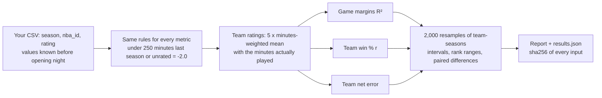

<!-- Assistant draft (2026-10-29), for Aayo to edit before release. Headings, captions and table notes are the
assistant's wording. -->
# Hoop Impact Bench (HIB)

**Do last season's impact-metric values predict this season?**


An open benchmark for NBA player impact metrics (RAPM, EPM, DARKO, LEBRON, BPM and the rest). An impact metric says a
player is worth so many points per 100 possessions. HIB checks that claim the one way that does not depend on trusting
the metric's author: it takes the values known before a season started and measures how well they predict that season.
Every metric is scored on the same 7,230 games under the same rules, every score comes with an interval, and every
published number can be rerun by anyone.

## News

- **2026-10-30**: v1.0.0, with the launch results for nine public metrics (EPM in two versions), 2020-21 to 2025-26.

## Results

**Established players** (v1 rules: a player with under 250 minutes the season before, rookies included, counts as
-2.0, for every metric). Regular seasons 2020-21 to 2025-26: 7,230 games, 180 team-seasons. Sorted by game margins.

| Rank | Metric | Game margins R² (90% interval) | Team win % r | Team net error (pts) |
|---|---|---|---|---|
|  | *Same-season RAPM (ceiling: it has seen the games)* | .268 (.251-.286) | .949 | 1.68 |
| 1-2 | Pulse | .171 (.154-.187) | .800 | 3.13 |
| 1-3 | LOKI † | .170 (.152-.186) | .805 | 3.08 |
| 3-6 | EPM, before the 2026-27 remodel | .163 (.146-.179) | .779 | 3.27 |
| 3-6 | OpenRAPM | .162 (.146-.178) | .786 | 3.39 |
| 3-7 | xRAPM | .161 (.144-.177) | .772 | 3.48 |
| 3-9 | LEBRON | .159 (.142-.175) | .770 | 3.39 |
| 5-9 | EPM, current model | .157 (.141-.174) | .778 | 3.87 |
| 6-10 | DARKO | .155 (.138-.172) | .767 | 3.36 |
| 6-10 | BPM (Basketball-Reference) | .154 (.136-.170) | .773 | 3.50 |
| 7-10 | ARC, 2-year † | .152 (.135-.169) | .776 | 3.38 |
|  | *Everyone 0 (floor)* | .125 (.109-.141) | .678 | 4.65 |
|  | *Last season's team net rating (floor)* | .103 (.087-.120) | .629 | 4.19 |

**Full forecast** (the same files with no low-minute rule, so each metric's own values for rookies and low-minute
players count).

| Rank | Metric | Game margins R² (90% interval) | Team win % r | Team net error (pts) |
|---|---|---|---|---|
|  | *Same-season RAPM (ceiling: it has seen the games)* | .288 (.270-.305) | .963 | 2.13 |
| 1 | LOKI † | .196 (.178-.213) | .828 | 3.47 |
| 2-3 | EPM, current model | .178 (.161-.194) | .808 | 4.44 |
| 2-4 | Pulse | .177 (.159-.192) | .807 | 3.09 |
| 4-6 | EPM, before the 2026-27 remodel | .171 (.154-.187) | .788 | 3.28 |
| 3-6 | OpenRAPM | .171 (.154-.187) | .801 | 3.40 |
| 4-6 | xRAPM | .169 (.152-.185) | .782 | 3.47 |
| 7-9 | DARKO | .159 (.142-.175) | .773 | 3.31 |
| 7-10 | ARC, 2-year † | .156 (.138-.172) | .782 | 3.34 |
| 7-10 | BPM (Basketball-Reference) | .154 (.138-.170) | .768 | 3.59 |
| 7-10 | LEBRON | .154 (.137-.169) | .766 | 3.38 |
|  | *Last season's team net rating (floor)* | .092 (.077-.108) | .609 | 4.18 |
|  | *Everyone 0 (floor)* | .000 (.000-.000) | .000 | 5.04 |

How to read the tables:

- **Rank** is a 90% range from 2,000 resamples, not a single place. Metrics whose ranges overlap are not separated by
  this data. On game margins, differences under about .006 to .007 are within the noise; the paired difference between every
  two metrics is in `launch/*.json` (`python eval.py --pairs` prints them).
- **Team net error** takes each team's rating at face value, so it also grades a metric's scale. A metric can rank
  players well and still miss here if its spread is too wide or too narrow.
- Rows in *italics* are references, not entries: the floors show what knowing nothing gets you, and the ceiling shows
  what a rating that has already seen the season gets.

Where each metric's values come from (full detail, sources and sha256 in `launch/provenance.csv`):

- † **LOKI and ARC are made by LUMA Basketball Research, which maintains HIB.** LOKI's past seasons were generated in
  2026 by its current model.
- **DARKO, LEBRON, Pulse, xRAPM, Basketball-Reference's BPM and current-model EPM** are each metric's own values for
  past seasons as published today, not copies saved at the time.
- **EPM before the remodel** is the only metric here taken as it was published before each season: Wayback Machine
  captures for 2020-21 to 2024-25, and for 2025-26 the site's own view dated two days into that season, saved before the
  remodel.
- **OpenRAPM's** box-score prior was trained on RAPM from every other season, later ones included.
- The third-party files are not in this repository; their scores and fingerprints are. See
  [Reproduce the results](#reproduce-the-results).

## Quick start

```
git clone https://github.com/lumahoops/hoop-impact-bench && cd hoop-impact-bench
pip install -r requirements.txt         # numpy and pandas
python eval.py                          # score the bundled metrics
python eval.py --ratings my_metric.csv  # add yours
python check.py                         # rerun every published result and compare
```

A run takes a few seconds, prints a report, and saves a folder `runs/<date_time>/` with:

- `results.json`: every score, its interval and rank range, the paired difference between every two metrics, and a
  sha256 fingerprint of each input file (Windows line endings count as Mac/Linux ones, so both copies of a file match);
- `games.csv`: every game's actual margin and each metric's predicted margin;
- `teams.csv`: every team-season's win %, opponent-adjusted margin and each metric's team rating.

## How it works



### Your file

One CSV per metric, named after it (`my_metric.csv`):

```
season,nba_id,rating
2024-25,1628983,7.85
2024-25,203999,8.10
```

- `season`: the season being predicted, like `2024-25`.
- `nba_id`: NBA.com person id.
- `rating`: points per 100 possessions above league average, **known before that season's opening night**: last
  season's value, or a preseason projection. A value computed after opening night has seen the games it is predicting.

A file with a missing column, a bad season, a non-numeric id or rating, or two ratings for one player-season is refused
with the row number. Two warnings at the top of the report catch the usual mistakes: a file that rates under 90% of the
minutes of players with 250+ minutes last season (its ids are usually not NBA.com ids), and a file whose average player
with 250+ minutes is more than 1.5 points from 0 (it is not in points per 100 above average). PER, Win Shares and other
stats on their own scale have to be converted first: for PER, subtract 15 (league average) and rescale.

### The rules (the same for every metric)

From Taylor Snarr's 2020 retrodiction study (the 250-minute cutoff is Neil Paine's):

- players who played under 250 minutes the season before, rookies included, count as **-2.0** (replacement level);
- players missing from your file count as -2.0.

A team's rating, in a game or over a season, is 5 x the minutes-weighted mean of its players' values, using the minutes
they actually played. So HIB tests the ratings, not a minutes forecast: every metric gets the same, real minutes.

### The tests

| Test | Question | Score | Credit |
|---|---|---|---|
| Game margins | How much of each game's final margin do the ratings explain? | R² | |
| Team win % | Do better-rated teams win more? | r | Krishna Narsu (2024) |
| Team net rating | How far is the team rating, taken at face value, from the team's opponent-adjusted margin? | RMSE (points) | Taylor Snarr (2020) |
| Rebuilt rosters | The same tests on the third of games and teams that kept the least of last season's minutes | | Snarr (2020), roster continuity |

Every score has a bootstrap interval: team-seasons are resampled, and every metric is scored on the same resamples.
Rank ranges and paired differences (metric A minus metric B on each resample) come from the same resamples. Nothing is
combined into one overall score.

## Options

| Option | Effect |
|---|---|
| `--ratings PATH ...` | Add metrics: CSV files or folders of CSVs |
| `--no-bundled` | Leave out the metrics in `ratings/` |
| `--baselines` | Add the reference rows, not ranked: every player 0, each player = his main team's opponent-adjusted margin last season / 5, and RAPM fit on the season being scored (the ceiling) |
| `--by-season` | Also print every score season by season |
| `--pairs` | Also print each metric minus the leader with paired intervals (a tie when the interval holds 0), the noise level, and which metrics beat the floors |
| `--confidence 0.95` | Interval level (default 0.90) |
| `--min-minutes 0` | No low-minute rule: every file is scored as-is (rookie projections count), and only players missing from a file get the replacement value. Default 250 |
| `--replacement -1.0` | The value those players get. Default -2.0 |
| `--resamples 5000` | Bootstrap resamples. Default 2000, at least 100 |
| `--out FOLDER` | Where to save the run (default `runs/<date_time>`) |

Runs with other rules, or with a file that covers fewer seasons than the v1 window, are marked **custom** in the report
and in `results.json` (`meta.standard`): compare them only with runs under the same rules and seasons.

## Add your metric

1. Make your CSV (above) and run `python eval.py --ratings my_metric.csv`.
2. To be added to the results table, open an issue with your `results.json`. If you share the CSV too, we rerun it and
   the entry is marked **verified**; if not, it is marked **self-reported** (`results.json` must come from this
   release: its harness fingerprint is checked). Say where the values come from and when they were made.

## Reproduce the results

```
python check.py                              # every published run: results/ and launch/
python check.py --ratings YOUR_COPIES        # also use your copies of the third-party files
python check.py --strict                     # fail unless every row of every run is reproduced
```

`check.py` reruns `eval.py` on the same inputs and compares every number. Each run gets one line: **OK** (every row
reproduced), **PARTIAL** (every row you hold the files for is reproduced; the rest are listed as not checked) or
**FAIL**. A metric's scores do not depend on the other metrics in a run, so each metric you hold is checked on its own;
rank ranges are checked when you hold every file. Your copies can have any file names: a copy counts only if its
sha256 matches the one in `launch/provenance.csv`, which also says where to get each file.

```
python tests/test_hib.py                     # the file reader and fingerprints
python tests/test_scoring.py                 # the scoring: known answers, the rookie rule, reference rows
```

## Versions

A version fixes the rules, the tests and the seasons, so scores are comparable only within a version. A change to any of
them is a new major version, and every result is rerun; fixes that change no score are minor versions. Every
`results.json` records the version and the sha256 of the `eval.py` that made it.

## What is in this repository

| Path | Contents |
|---|---|
| `eval.py` | The benchmark: reads the files, applies the rules, scores, resamples, reports |
| `check.py` | Reruns every published result and compares |
| `tests/` | Tests of the file reader, the fingerprints and the scoring |
| `tools/from_bbref.py` | Turns Basketball-Reference "Advanced" tables you export into a ratings file (`--column BPM` by default) |
| `data/games.csv` | Regular-season scores, 2019-20 to 2025-26 (`neutral` = 1 for neutral-site games, including the 2020 Orlando restart) |
| `data/minutes.csv` | Minutes per player per game, same seasons (2019-20 only supplies last-season minutes) |
| `data/players.csv` | NBA.com id and name for every player-season, 2019-20 to 2025-26 |
| `ratings/` | Bundled metrics: LOKI and a research variant with a BPM prior (`loki_bpm`), ARC over 1, 2 and 3 seasons ending the season before (LUMA's published boards), and OpenRAPM by Nathan Walker (github.com/bbstats/openrapm, MIT, snapshot 2026-10-29, previous-season values) |
| `reference/rapm_same_season.csv` | Plain RAPM (ridge regression on lineup stints, no prior) fit on the season itself: the ceiling row |
| `results/` | The published run of the bundled metrics |
| `launch/` | The two runs behind the results table (scores only) and `provenance.csv` |

Other people's ratings (EPM, DARKO, LEBRON, Pulse, xRAPM, Basketball-Reference's BPM, your own RAPM, ...) belong to
their authors and are not in this repository. To score Basketball-Reference's BPM: export each season's Advanced table
(Share & Export > Get table as CSV), then
`python tools/from_bbref.py 2019-20=bbref_2019-20.csv ... 2024-25=bbref_2024-25.csv --out bpm_bbref.csv`. Each table
becomes the preseason ratings for the next season; traded players use their season-total row.

## Credit, citation and license

The rules and the team net rating test are Taylor Snarr's (Dunks & Threes, 2020), the win % test is Krishna Narsu's
(2024), and the 250-minute cutoff is Neil Paine's. Game and minutes data are from NBA.com.

Copyright 2026 Court Share LLC. Code: MIT (`LICENSE`). Data and ratings: CC BY 4.0 (`LICENSE-DATA`), except
`ratings/openrapm.csv` (Nathan Walker, MIT, `ratings/OPENRAPM_LICENSE.txt`). Credit: LUMA Basketball Research
(https://lumahoops.org). To cite HIB, use `CITATION.cff` (GitHub's "Cite this repository" button).

Questions, results and holes found: open an issue.
