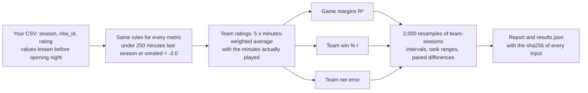

<!-- Assistant draft (2026-10-29), for Aayo to edit before release. Headings, captions, table notes and the plain-English
definitions are the assistant's wording. -->
# Hoop Impact Bench (HIB)

Do last season's impact-metric values predict this season?


HIB is an open benchmark for NBA player impact metrics such as RAPM, EPM, DARKO, LEBRON and BPM. An impact metric
says how many points per 100 possessions a player adds to his team. HIB tests that number without having to trust
whoever made it: it takes each metric's values from before a season started and measures how well they predict that
season's games. Every metric is scored on the same 7,230 games under the same rules. Each score has an interval, and
anyone can rerun every published number.

## News

- 2026-10-30: version 1.0.0 and the first results, nine public metrics over the 2020-21 to 2025-26 seasons.

## Results

The tables score each metric's ratings from before each season on the regular seasons 2020-21 to 2025-26 (7,230 games,
180 team-seasons), sorted by the first test. The tests are explained under [How it works](#how-it-works) and the terms
under [Plain English](#plain-english).

### Established players

Under the v1 rule, from [Taylor Snarr's 2020 study](https://dunksandthrees.com/blog/metric-comparison), a player who
played under 250 minutes the season before, rookies included, counts as -2.0 for every metric.

| Rank | Metric | Game margins R² (90% interval) | Team win % r | Team net error (points) |
|---|---|---|---|---|
|  | *Same-season RAPM (ceiling)* | .268 (.251-.286) | .949 | 1.68 |
| 1-2 | Pulse | .171 (.154-.187) | .800 | 3.13 |
| 1-2 | LOKI † | .170 (.152-.186) | .805 | 3.08 |
| 3-5 | OpenRAPM | .162 (.146-.178) | .786 | 3.39 |
| 3-6 | xRAPM | .161 (.144-.177) | .772 | 3.48 |
| 3-8 | LEBRON | .159 (.142-.175) | .770 | 3.39 |
| 4-8 | EPM | .157 (.141-.174) | .778 | 3.87 |
| 5-9 | DARKO | .155 (.138-.172) | .767 | 3.36 |
| 5-9 | BPM (Basketball-Reference) | .154 (.136-.170) | .773 | 3.50 |
| 6-9 | ARC, 2-year † | .152 (.135-.169) | .776 | 3.38 |
|  | *Everyone 0 (floor)* | .125 (.109-.141) | .678 | 4.65 |
|  | *Last season's team (floor)* | .103 (.087-.120) | .629 | 4.19 |

### Full forecast

The same files with no low-minute rule, so each metric's own values for rookies and low-minute players count.

| Rank | Metric | Game margins R² (90% interval) | Team win % r | Team net error (points) |
|---|---|---|---|---|
|  | *Same-season RAPM (ceiling)* | .288 (.270-.305) | .963 | 2.13 |
| 1 | LOKI † | .196 (.178-.213) | .828 | 3.47 |
| 2-3 | EPM | .178 (.161-.194) | .808 | 4.44 |
| 2-3 | Pulse | .177 (.159-.192) | .807 | 3.09 |
| 3-5 | OpenRAPM | .171 (.154-.187) | .801 | 3.40 |
| 4-5 | xRAPM | .169 (.152-.185) | .782 | 3.47 |
| 6-8 | DARKO | .159 (.142-.175) | .773 | 3.31 |
| 6-9 | ARC, 2-year † | .156 (.138-.172) | .782 | 3.34 |
| 6-9 | BPM (Basketball-Reference) | .154 (.138-.170) | .768 | 3.59 |
| 6-9 | LEBRON | .154 (.137-.169) | .766 | 3.38 |
|  | *Last season's team (floor)* | .092 (.077-.108) | .609 | 4.18 |
|  | *Everyone 0 (floor)* | .000 (.000-.000) | .000 | 5.04 |

How to read the tables:

- Rank is the range of places a metric took in the middle 90% of 2,000 resamples. When two metrics' ranges overlap,
  this data does not separate them. On game margins, gaps under about .006 are within the noise; `python eval.py
  --pairs` prints the paired difference between every two metrics.
- Team net error takes each team's rating at face value, so it also grades a metric's scale. A metric can order players
  well and still score badly here if its ratings are spread too wide or too narrow.
- Rows in italics are references and are not ranked. The floors know nothing about the players. The ceiling is RAPM fit
  on the season being scored, so it has already seen the games.
- † LOKI and ARC are made by LUMA Basketball Research, which maintains HIB.

### The metrics

| Metric | Made by | Where | Value used for each season |
|---|---|---|---|
| LOKI † | LUMA Basketball Research | [lumahoops.org](https://lumahoops.org) | Preseason rating. Past seasons were generated in 2026 by the current model. |
| ARC, 2-year † | LUMA Basketball Research | [lumahoops.org](https://lumahoops.org), [open data](https://github.com/lumahoops/NBA) | ARC over the two seasons that end the season before |
| OpenRAPM | Nathan Walker | [GitHub](https://github.com/bbstats/openrapm), [site](https://bbstats.github.io/openrapm/) | Previous season. Its box-score prior was trained on RAPM from every other season, later ones included. |
| Pulse | CourtSignal | [courtsignal.net](https://courtsignal.net/ratings) | Previous season |
| xRAPM | Jeremias Engelmann | [xrapm.com](https://xrapm.com/) | Previous season |
| LEBRON | BBall Index | [bball-index.com](https://www.bball-index.com/lebron-application/) | Previous season |
| EPM | Taylor Snarr, Dunks & Threes | [dunksandthrees.com](https://dunksandthrees.com/epm) | The site's value on each team's first game day, before that day's games |
| DARKO | Kostya Medvedovsky | [darko.app](https://www.darko.app/) | The site's value on the day before each opening night |
| BPM | Basketball-Reference (BPM 2.0 by Daniel Myers) | [basketball-reference.com](https://www.basketball-reference.com/about/bpm2.html) | Previous season. Traded players use their season-total row. |

Apart from LOKI's, these are the values each site shows today for past seasons, made by each metric's current version.
Models change over time, so a past season is scored with the version a metric has now, which may differ from the one it
had then. The files for Pulse, xRAPM, LEBRON, EPM, DARKO and BPM belong to their makers and are not in this repository.
Their scores are in `launch/`, and `launch/provenance.csv` gives each file's source, the date it was pulled and its
sha256 fingerprint, so anyone who gets the same file can check our numbers.

## Quick start

```
git clone https://github.com/lumahoops/hoop-impact-bench && cd hoop-impact-bench
pip install -r requirements.txt         # numpy and pandas
python eval.py                          # score the bundled metrics
python eval.py --ratings my_metric.csv  # add yours
python check.py                         # rerun every published result and compare
```

A run takes a few seconds, prints a report, and saves a folder `runs/<date_time>/` with:

- `results.json`: every score with its interval and rank range, the paired difference between every two metrics, and
  the sha256 fingerprint of each input file;
- `games.csv`: every game's actual margin and each metric's predicted margin;
- `teams.csv`: every team-season's win %, opponent-adjusted margin and each metric's team rating.

## How it works



### Your file

One CSV per metric, named after it (`my_metric.csv`):

```
season,nba_id,rating
2024-25,1628983,7.85
2024-25,203999,8.10
```

- `season` is the season being predicted, like `2024-25`.
- `nba_id` is the player's NBA.com person id.
- `rating` is in points per 100 possessions above league average and must be known before that season's opening night:
  last season's value, or a preseason projection. A value computed after opening night has seen the games it predicts.

A file with a missing column, a bad season, a non-numeric id or rating, or two ratings for one player-season is refused
with the row number. The report also warns about two common mistakes. If a file rates under 90% of the minutes played
by players with 250+ minutes last season, its ids are usually not NBA.com ids. If its average player with 250+ minutes
is more than 1.5 points from 0, it is usually on another scale. PER, Win Shares and other stats on their own scale have
to be converted first: for PER, subtract 15 (the league average) and rescale.

### The rules

These come from [Taylor Snarr's 2020 retrodiction study](https://dunksandthrees.com/blog/metric-comparison). The
250-minute cutoff is [Neil Paine's](https://www.apbr.org/metrics/viewtopic.php?f=2&t=8196&start=15#p15334).

- A player who played under 250 minutes the season before, rookies included, counts as -2.0 (replacement level).
- A player missing from your file counts as -2.0.

A team's rating, in a game or over a season, is 5 times the minutes-weighted average of its players' values, using the
minutes they actually played. Every metric gets the same minutes, so playing time cannot favor one metric over another.

### The tests

| Test | Question | Score | Credit |
|---|---|---|---|
| Game margins | How much of each game's final margin do the ratings explain? | R² | |
| Team win % | Do better-rated teams win more often? | r | [Krishna Narsu (2024)](https://x.com/knarsu3/status/1763321501766627328) |
| Team net rating | How far is each team's rating, taken at face value, from its opponent-adjusted margin? | RMSE in points | [Taylor Snarr (2020)](https://dunksandthrees.com/blog/metric-comparison) |
| Rebuilt rosters | The same three tests on the third of games and teams that kept the least of last season's minutes | | Snarr (2020) |

Every score has a bootstrap interval. The 180 team-seasons are resampled 2,000 times, and every metric is scored on the
same resamples, which also give the rank ranges and the paired differences. The tests are reported side by side and are
never combined into one score.

## Plain English

The definitions start from the sources in the last column, in our own words.

| Term | What it means here | Source |
|---|---|---|
| Impact metric | A rating of how much a player adds to his team's point margin, in points per 100 possessions compared with an average player. | [Basketball-Reference glossary (BPM)](https://www.basketball-reference.com/about/glossary.html) |
| Possession | One trip down the floor that ends in a shot, a turnover or free throws. A team has about 100 a game, so points per 100 possessions is close to points per game. | [Basketball-Reference glossary (Poss, Pace)](https://www.basketball-reference.com/about/glossary.html) |
| Replacement level | About the level of a player any team can sign off the street. Basketball-Reference puts it at -2.0 points per 100 possessions, the value HIB gives players without a usable rating. | [Basketball-Reference glossary (VORP)](https://www.basketball-reference.com/about/glossary.html) |
| RAPM | Regularized adjusted plus-minus. For every stretch of play it records which ten players were on the court and how the score changed, then solves for each player's share. "Regularized" means every player is pulled toward zero until the data moves him. | [Jeremias Engelmann, how to build it](https://jeremiasengelmann.substack.com/p/nba-adjusted-plus-minus-how-to-build) |
| Retrodiction | Predicting a season that has already been played, using only what was known before it. The ratings are weighted by the minutes actually played in that season. | [Snarr (2020)](https://dunksandthrees.com/blog/metric-comparison) |
| Opponent-adjusted margin | A team's average margin after accounting for who it played and where. Zero is average. Basketball-Reference calls this the Simple Rating System (SRS); HIB fits it the same way, with a home-court term. | [Basketball-Reference glossary (SRS)](https://www.basketball-reference.com/about/glossary.html) |
| R² | The share of the game-to-game differences in final margin that the ratings account for, from 0 (none) to 1 (all). One game has a lot of luck in it, so even ratings that have seen the season reach only about .27. | [Coefficient of determination](https://en.wikipedia.org/wiki/Coefficient_of_determination) |
| r (correlation) | How closely two lists move together, from -1 to 1. Here: whether teams with higher ratings had higher win percentages. | [Pearson correlation](https://en.wikipedia.org/wiki/Pearson_correlation_coefficient) |
| RMSE (net error) | The typical size of a miss, in points. Square each team's miss, average the squares, then take the square root, so big misses count more. | [Root-mean-square deviation](https://en.wikipedia.org/wiki/Root_mean_square_deviation) |
| Roster continuity | The share of a team's minutes played by players who were on the same team the season before. The third of teams and games with the lowest share are the rebuilt rosters. | [Basketball-Reference, Roster Continuity](https://www.basketball-reference.com/friv/continuity.html) |
| Bootstrap resample | Draw 180 team-seasons at random from the 180, repeats allowed, and score every metric again. How much a score moves over 2,000 draws shows how sure the data can be about it. | [Bootstrapping (statistics)](https://en.wikipedia.org/wiki/Bootstrapping_%28statistics%29) |
| 90% interval | The middle 90% of a score's 2,000 resampled values. | [Bootstrapping (statistics)](https://en.wikipedia.org/wiki/Bootstrapping_%28statistics%29) |
| Rank range | The middle 90% of the places a metric took over the 2,000 resamples. | |
| Paired difference | Metric A's score minus metric B's on the same resample. Both see the same games, so luck that helps both cancels out. When the middle 90% of the differences includes 0, the data cannot tell the two apart. | |
| Floor and ceiling | Reference rows. The floors know nothing about the players (everyone at 0, or each player given his team's rating from last season). The ceiling is RAPM fit on the season being scored. | |
| sha256 fingerprint | A 64-character code computed from a file's exact contents. Change one character and the code changes, so two people whose files give the same code have the same file. Windows and Mac line endings count as the same. | [SHA-2](https://en.wikipedia.org/wiki/SHA-2) |

## Options

| Option | Effect |
|---|---|
| `--ratings PATH ...` | Add metrics: CSV files or folders of CSVs |
| `--no-bundled` | Leave out the metrics in `ratings/` |
| `--baselines` | Add the reference rows (unranked): everyone 0, each player's team from last season, and the same-season RAPM ceiling |
| `--by-season` | Also print every score season by season |
| `--pairs` | Also print each metric minus the leader with paired intervals (a tie when the interval holds 0), the noise level, and which metrics beat the floors |
| `--confidence 0.95` | Interval level (default 0.90) |
| `--min-minutes 0` | No low-minute rule: every file is scored as it is, and only players missing from a file get the replacement value. Default 250 |
| `--replacement -1.0` | The value those players get. Default -2.0 |
| `--resamples 5000` | Bootstrap resamples. Default 2000, at least 100 |
| `--out FOLDER` | Where to save the run (default `runs/<date_time>`) |

Runs with other rules, or with a file that covers fewer seasons than the v1 window, are marked custom in the report and
in `results.json` (`meta.standard`). Compare them only with runs under the same rules and seasons.

## Add your metric

1. Make your CSV (see [Your file](#your-file)) and run `python eval.py --ratings my_metric.csv`.
2. To be added to the results, open an issue with your `results.json`. If you share the CSV as well, we rerun it and
   the entry is marked verified. If you do not, it is marked self-reported, and the harness fingerprint in your
   `results.json` must match this release. Say where the values come from and when they were made.

## Reproduce the results

```
python check.py                              # every published run: results/ and launch/
python check.py --ratings YOUR_COPIES        # also use your copies of the third-party files
python check.py --strict                     # fail unless every row of every run is reproduced
```

`check.py` reruns `eval.py` on the same inputs and compares every number. Each run gets one line: OK when every row is
reproduced, PARTIAL when every row you hold the files for is reproduced and the rest are listed as not checked, FAIL
otherwise. A metric's scores do not depend on the other metrics in a run, so each metric you hold is checked on its
own; rank ranges are checked when you hold every file. Your copies can have any file names, since a copy counts only if
its sha256 matches the one in `launch/provenance.csv`.

```
python tests/test_hib.py                     # the file reader and fingerprints
python tests/test_scoring.py                 # the scoring: known answers, the rookie rule, reference rows
```

## Versions

A version fixes the rules, tests and seasons, and scores are comparable only within a version. A change to any of them
is a new major version, and every result is rerun. Fixes that change no score are minor versions. Every `results.json`
records the version and the sha256 of the `eval.py` that made it.

## What is in this repository

| Path | Contents |
|---|---|
| `eval.py` | The benchmark: reads the files, applies the rules, scores, resamples and reports |
| `check.py` | Reruns every published result and compares |
| `tests/` | Tests of the file reader, the fingerprints and the scoring |
| `tools/from_bbref.py` | Turns Basketball-Reference "Advanced" tables you export into a ratings file (`--column BPM` by default) |
| `data/games.csv` | Regular-season scores, 2019-20 to 2025-26 (`neutral` = 1 for neutral-site games, including the 2020 Orlando restart) |
| `data/minutes.csv` | Minutes per player per game, same seasons (2019-20 only supplies last season's minutes) |
| `data/players.csv` | NBA.com id and name for every player-season, 2019-20 to 2025-26 |
| `ratings/` | Bundled metrics: LOKI, a LOKI research variant with a BPM prior (`loki_bpm`), ARC over 1, 2 and 3 seasons, and OpenRAPM (MIT license, snapshot of 2026-10-29) |
| `reference/rapm_same_season.csv` | Plain RAPM (ridge regression on lineup stints, no prior) fit on each season itself: the ceiling row |
| `results/` | The published run of the bundled metrics |
| `launch/` | The two runs behind the results tables (scores only) and `provenance.csv` |

To score Basketball-Reference's BPM yourself, export each season's Advanced table (Share & Export > Get table as CSV),
then run `python tools/from_bbref.py 2019-20=bbref_2019-20.csv ... 2024-25=bbref_2024-25.csv --out bpm_bbref.csv`.
Each table becomes the ratings for the season after it.

## Credit, citation and license

The rules and the team net rating test come from [Taylor Snarr's 2020 study](https://dunksandthrees.com/blog/metric-comparison).
The team win % test is [Krishna Narsu's (2024)](https://x.com/knarsu3/status/1763321501766627328), and the 250-minute cutoff is
[Neil Paine's](https://www.apbr.org/metrics/viewtopic.php?f=2&t=8196&start=15#p15334). Game and minutes data are from
NBA.com.

Copyright 2026 Court Share LLC. Code: MIT (`LICENSE`). Data and ratings: CC BY 4.0 (`LICENSE-DATA`), except
`ratings/openrapm.csv` (Nathan Walker, MIT, `ratings/OPENRAPM_LICENSE.txt`). Credit: LUMA Basketball Research
([lumahoops.org](https://lumahoops.org)). To cite HIB, use `CITATION.cff` (GitHub's "Cite this repository" button).

Questions, results and holes found: open an issue.
